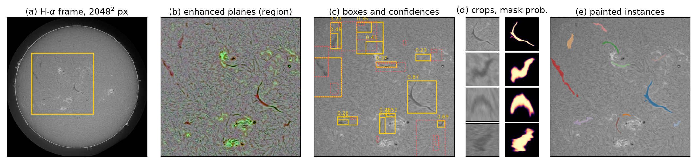

# Solar filament segmentation: detect, crop, segment, paint

Solution to the [Solar Filament Segmentation Challenge 2026](https://www.kaggle.com/competitions/filament-segmentation-2026)
(IEEE BigData Cup; MAGFiLO annotations on GONG H-alpha frames; metric: Panoptic Quality).

| | |
|---|---|
| Out-of-fold PQ (707 training photos, 5 folds grouped by date) | **0.4582** (95% CI 0.4487–0.4664), SQ 0.6911, RQ 0.6630 |
| Public leaderboard PQ | **0.40** |
| Reference: one human annotator scored against another | PQ 0.3398 (SQ 0.6329, RQ 0.5369) |
| Test inference | ~3.7 s per frame on one T4 |



## Method in five lines

1. **Detect.** A YOLO11m box detector on the full frame (1280 px) proposes filaments and gives each a confidence.
   It is trained on the boxes of *every* annotator record, so the confidence reflects how likely an annotator is to
   mark the structure. A second copy of each detector is self-trained with 3,000 unlabeled GONG archive frames.
2. **Crop.** Each box is cut out of the 2048-px frame with 20% padding and resized to 512 px, so thin filaments
   and barbs are segmented at (or above) native resolution.
3. **Segment.** A U-Net++ / EfficientNet-B4 outlines the filament the box points at. Its input is three enhanced
   planes (black top-hat, background-flattened, Sato ridge) in robust disk units.
4. **Paint.** Instances are laid down in confidence order; a pixel belongs to the first instance that claims it,
   so masks never overlap. Which instances are emitted (mask threshold, confidence floor, drop rule) is chosen
   once, on out-of-fold PQ.
5. **Ensemble.** Every model exists five times (5-fold cross-validation). On the test set detectors are fused by
   Weighted Boxes Fusion over folds and flips; segmenters are averaged over folds and flips.

Details, ablations and failure cases: [`report/report.pdf`](report/report.pdf).

## Reproduce the submission

The notebook [`notebooks/pipeline.ipynb`](notebooks/pipeline.ipynb) runs everything (setup, pre-processing, optional
training, inference with the weights in `weights/`, post-processing, evaluation, examples). On Kaggle: add the
competition data, enable a GPU, run all. From a shell:

```bash
pip install -r requirements.txt
export MAGFILO_ROOT=/path/to/MAGFiLO_1.0_Kaggle_2026      # contains train/ and test/
export FILSEG_WEIGHTS=$PWD/weights                        # released models
python run.py predict --run final --det m1280 --seg e4 --test
mkdir -p work/cache/final && cp results/tune_final.json work/cache/final/tune.json
python run.py submit --run final --out submission.csv
```

`results/submission.csv` is the file submitted to Kaggle. GPU arithmetic is not bit-reproducible across devices;
the notebook compares the regenerated file with it instance by instance.

## Train from scratch

```bash
python run.py planes                                       # cache the enhanced planes (11 GB)
for k in 0 1 2 3 4; do
  python run.py det --fold $k --name m1280                 # detector
  python run.py seg --fold $k --name e4                    # crop segmenter
  python run.py pseudo --fold $k --det m1280 --src work/gong            # self-training set (python scripts/fetch_gong.py work/gong)
  python run.py det --fold $k --name m1280s --extra m1280 --epochs 20   # student detector
  python run.py predict --run final --det m1280 --seg e4 --fold $k   # out-of-fold proposals
done
python run.py tune --run final                             # emission rule + out-of-fold PQ
```

About 15 GPU-hours on a T4 for all folds. `FILSEG_SMOKE=6` restricts every step to six photos (code check in minutes).

## Repository

```
run.py                 command line: planes, det, pseudo, seg, predict, tune, submit
filseg/data.py         paths, annotation index (photo -> annotator records), date-grouped folds
filseg/enhance.py      input planes: black top-hat, flattened, Sato ridge
filseg/detector.py     YOLO11 training, flip TTA + Weighted Boxes Fusion, self-training on unlabeled frames
filseg/segmenter.py    crop dataset, U-Net++ / EfficientNet-B4, loss, training, TTA inference
filseg/postprocess.py  confidence-ordered painting, proposal cache
filseg/metric.py       Panoptic Quality and overlap statistics as in the organisers' self-evaluation notebook
filseg/submission.py   CSV writer and validator (ids, RLE, no overlaps)
folds/folds.json       the split every reported number uses
weights/               released models (5 folds each)
results/               emission rule, out-of-fold metrics, the submitted CSV
notebooks/             end-to-end demo notebook
report/                technical report (LaTeX sources and PDF)
scripts/               figures of the report, downloader for the unlabeled GONG frames
remote/, jobs/         how the models were trained on Kaggle and Colab GPUs (not needed to reproduce)
```

## Data and rules

* Supervision comes only from the competition's training annotations. The public MAGFiLO release (which contains
  annotations of the test frames) was never used, neither for training nor for model selection.
* The unlabeled frames for self-training are public GONG archive JPEGs without annotations; none is a competition
  frame and none was taken on a test date.
* Inference uses the supplied test frame only: no metadata, no neighbouring frames.
* Pre-trained weights: ImageNet (EfficientNet-B4) and COCO (YOLO11m).

## Licence

Code and weights: AGPL-3.0 (the detector is built on Ultralytics YOLO, which is AGPL-3.0).
